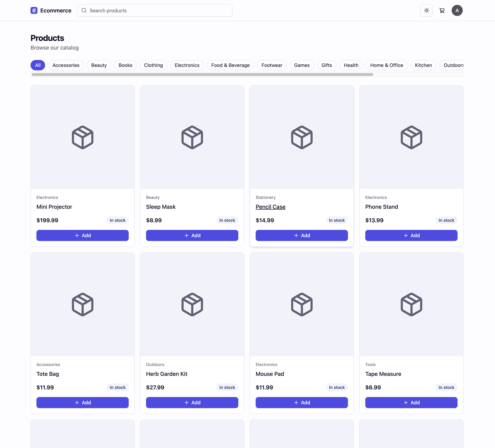
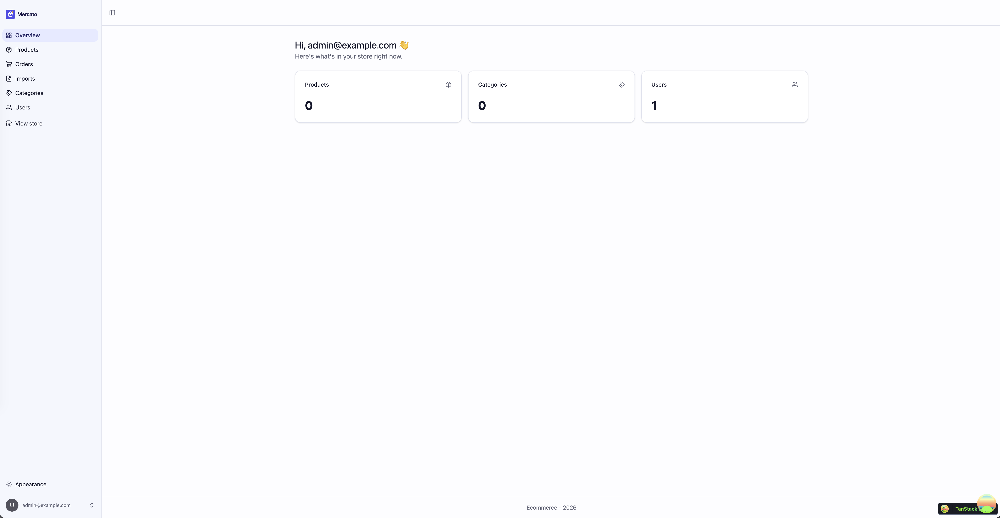
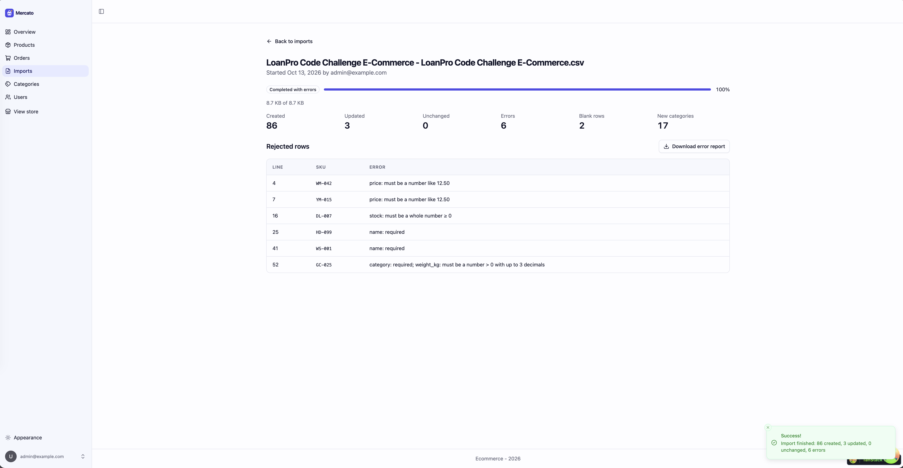
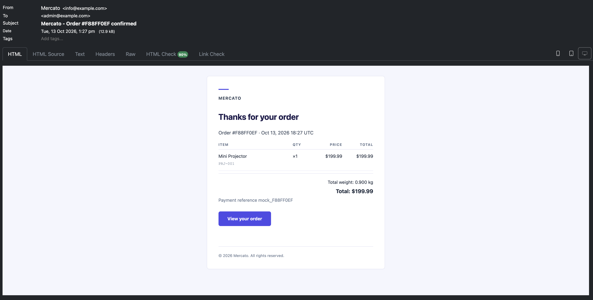

# Mercato

<p align="center">
  
</p>
<p align="center">
  <a href="./architecture.md"> · Architecture · </a>
</p>

> **_Note:_** The CSV file provided was downloaded on Fri 16/10

## Technology Stack and Features

- ⚡ [**FastAPI**](https://fastapi.tiangolo.com) for the Python backend API.
  - 🔖 [FastAPI fullstack template](https://github.com/fastapi/full-stack-fastapi-template) for the initial setup.
  - 💾 [PostgreSQL](https://www.postgresql.org) as the SQL database.
  - 📋 [Redis](https://redis.io) for cache.
- 🚀 [React](https://react.dev) for the frontend.
  - 🎨 [Tailwind CSS](https://tailwindcss.com) and [shadcn/ui](https://ui.shadcn.com) for the frontend components.
  - 🧪 [Playwright](https://playwright.dev) for end-to-end testing.
- 🐋 [Docker Compose](https://www.docker.com) for local services and self-hosted deployment.
  - 📞 [Nginx](https://nginx.org) as a reverse proxy and load balancer across backend replicas, with HTTPS via certbot.
  - ⚙️ [Celery](https://docs.celeryq.dev) workers and Beat scheduler, with a dedicated Redis broker and a separate Redis cache.
  - 🗄️ S3-compatible object storage (RustFS locally) accessed with boto3.
  - 🔎 [Elasticsearch](https://www.elastic.co/elasticsearch) as a search engine for efficient search.

### Run the project

I recommend running in dev mode, so you can test the E2E experience frictionlessly.

To run the backend stack, execute:

```bash
docker compose up -d
```

This command creates the following containers/volumes:

- Backend app
- Postgres database with its volume
- Redis cache
- Redis message broker with its volume
- Mailpit to test emails locally
- Elasticsearch
- RustFS with its volume
- Celery worker
- Celery Beat
- Search indexer worker
- Adminer (optional, to inspect data)

To start the client React dev server:

```bash
npx bun run dev
```

Use the following commands to apply migrations and create an admin user (please double-check the backend container name matches yours):

```bash
docker compose exec backend alembic upgrade head
docker compose exec backend python app/initial_data.py

Log in with
Admin: admin@example.com
Pass: Testing1234*
```

Below are listed some useful URLs you can use while testing:

- <http://localhost:5173/> -> Storefront
- <http://localhost:5173/admin> -> Backoffice admin panel
- <http://localhost:9001/rustfs/console/browser/> -> RustFS console
- <http://localhost:8025/> -> Email client
- <http://localhost:8000/docs> -> OpenAPI docs

#### Run project in production mode (optional)

Below are the instructions to run the project in production mode. This mode lacks some E2E integrations, like the SMTP config, so we encourage you to run it in dev mode for local testing.

This project was designed to run multiple backend instances, so if you have enough headroom on your laptop, allocate at least 6GB of RAM in Docker and increase the number of backend instances.

First, you'll need to create certificates (production env routes to HTTPS).

```bash
bash scripts/local-certs.sh
```

Build and start the app (production setup needs a single build for the whole app):

```bash
docker compose -p ecommerce-prod --env-file .env.prod.example -f compose.prod.yml up -d --build
```

Seed initial data (create admin user)

```bash
docker exec -t ecommerce-prod-backend-1 python app/initial_data.py

Login with
Admin: admin@example.com
Pass: Testing1234*
```

To stop the app run the following command (do not forget `-v`, to remove volumes as well).

```bash
docker compose -p ecommerce-prod --env-file .env.prod.example -f compose.prod.yml down -v
```

### Storefront



### Dashboard - Admin



### Dashboard - File import



### Mailpit - Local Email Testing


