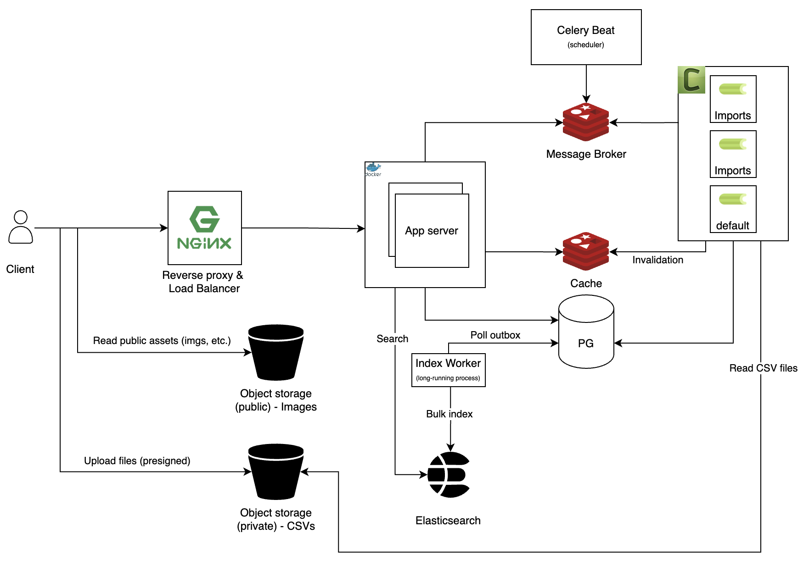
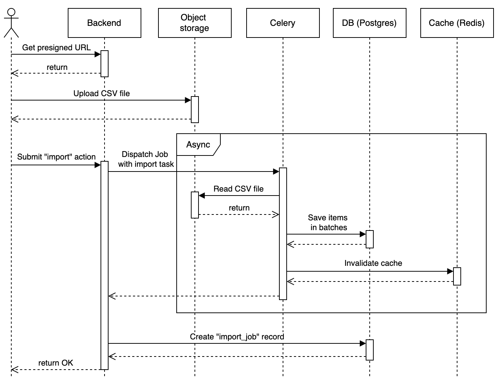
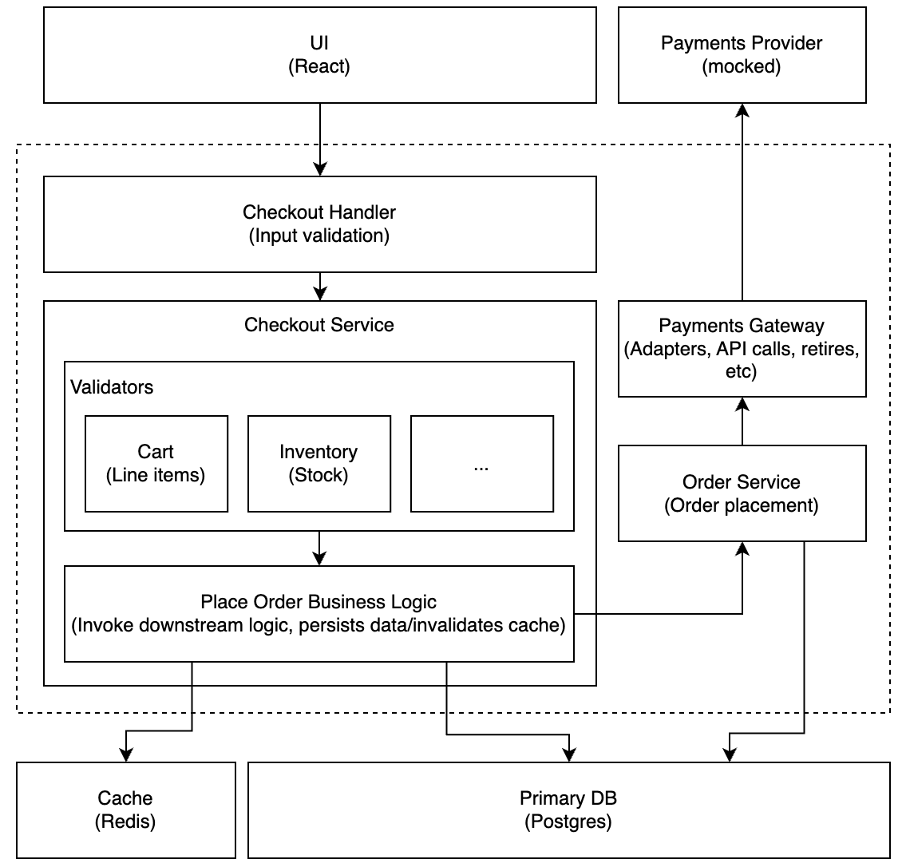
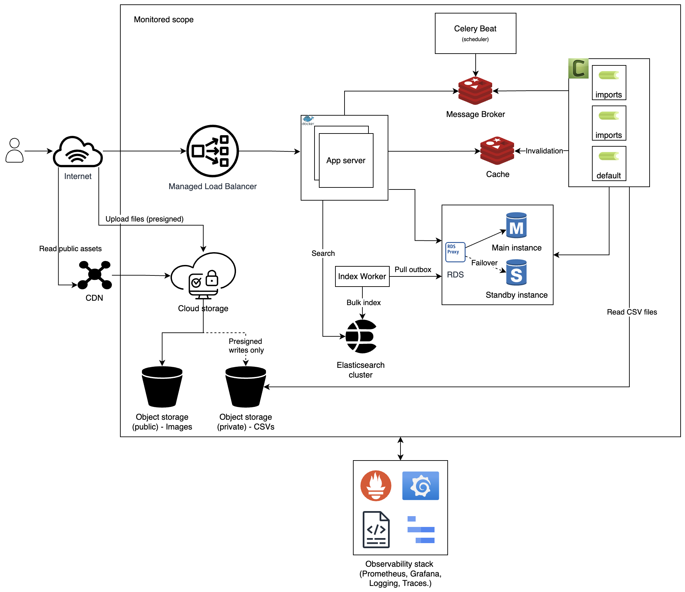

# Table of contents

- [Architecture](#architecture)
  - [CSV Import](#csv-import)
  - [Search Index Worker](#search-index-worker)
  - [Checkout](#checkout)
- [Production Readiness](#production-readiness)
- [Trade-offs and decisions made](#trade-offs-and-decisions-made)

# Architecture

The image below shows the backend architecture used to build this project.

## CSV Import

To import the CSV, the users upload the files first and then start the import task by hitting the "Import" button in the UI. This action triggers a Celery Task that creates the records in the DB async, so if the user loses connection, the import still runs as expected.

This import task is idempotent to prevent duplications. Also, any new addition or update is visible to the Search Index worker, so items get indexed in Elasticsearch right after the addition. In addition, any item update triggers a cache invalidation to prevent stale data in the cache layer.

To report progress, the system creates an import job record in the database that stores the bytes processed against the total file size; that way clients can see the process with a cheap calculation.

## Search Index Worker

Product changes reach Elasticsearch through a Transactional Outbox (a SQLAlchemy `before_flush` listener writes an `outbox_event` row in the same transaction as the change). On the other hand, a long-running process polls the outbox table periodically to look for new events and trigger a reindex process.

## Checkout

The following diagram shows how the checkout flow was designed.

When the consumer places the order, the `CheckoutService` validates the cart (eg, itemavailability) and places a new order through the `OrderService`.

The orders might have 4 different states:

- Draft: the consumer added an item to the cart, but the order hasn't been placed
- In progress: the consumer placed the order
- Cancelled: an admin cancelled the order
- Completed: an admin completed the order

> **_Note:_** The payment provider was omitted for this project

# Production Readiness

The architecture described above was simplified to facilitate the development process and functional demo; however, a production-ready app would need to eliminate single point of failure instances (such as Nignx in this case), have managed load balancer and DB/cache instances (so standby instances can be configured), and include a good set of observability tools.

The diagram below shows something closer to a production-ready architecture.

# Trade-offs and decisions made

1. I chose a layered architecture for simplicty. given the size of the project. Layers implemented are: presentation (HTTP routes/endpoints/handlers), services, repositories, and models
2. I used a simple Authn/Authz mechanism with user and password. A real-world app would include more sophisticated and secure mechanisms.
3. I didn't implement or integrate observability tools to focus on the main features. However, a production-ready setup should include at least logs, metrics (infra and business), and traces along with appropriate alerts to monitor the system.
4. This project uses Nginx as a reverse proxy + load balancer for simplicity; however, this is a single point of failure. In production, either a managed load balancer or a Kubernetes orchestrator must be used.
5. The long-running Search Index Worker was designed to poll the DB to look for new events. The polling was made for simplicity, but in a real production environment, a CDC pattern (or similar) would be more efficient.
6. The CSV importer has a known issue: if multiple users try to update the same product concurrently, we'll have a race condition and the result will be unpredictable (the system always takes the latest update). To solve this issue, a better approach would be to enqueue requests rather than processing them on demand, so these collisions can be treated gracefully.
7. FastAPI uses pools of DB connections, which helps reduce the number of connections to the DB; however, in a real environment, this should be carefully analyzed to prevent connection exhaustion: the database should handle `(#of replicas x uvicorn workers) + (#celery worker nodes) * search index worker + celery beat` number of connections.
8. This project handles secrets using plain `.env` files. In production a secrets management system must be used for security

